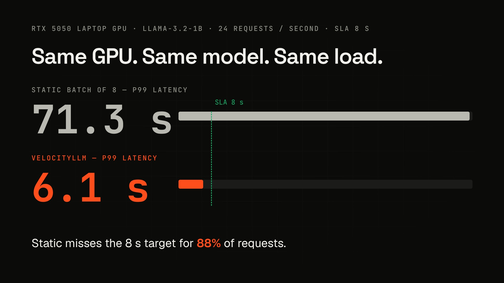

<div align="center">


<br/>


**A dynamic / continuous batching scheduler engine for LLM inference serving —**
**built to prove, with live numbers, that intelligent scheduling raises GPU throughput and SLA reliability over traditional static batching.**

[Overview](#overview) • [Demo](#demo) • [Prerequisites](#prerequisites) • [Setup](#setup) • [Run](#run-the-project) • [Test](#test-the-project) • [Troubleshooting](#troubleshooting--common-fixes)

</div>

---

## Overview

**VelocityLLM** is an industry-grade systems engineering project that tackles a real production problem in LLM serving: **static batch sizes under-utilize GPU throughput and silently break latency promises under variable request loads.**

This project builds a **dynamic/continuous batching scheduler** on top of [vLLM](https://github.com/vllm-project/vllm) that:

- Enforces configurable **latency SLAs** via a predictive, SLA-aware admission controller
- Adapts its concurrency ceiling in real time using an **AIMD feedback controller** driven by live GPU utilization and memory headroom
- Prioritizes requests with **anti-starvation aging**, so low-priority traffic is never indefinitely starved
- Survives real failure conditions — GPU OOM, client disconnects, malformed input, traffic bursts — without crashing or silently degrading
- Is **model-agnostic** — the scheduler only reasons about request metadata (arrival time, token counts, priority), never model internals, so it works with any vLLM-supported model
- Compares itself against a static-batching baseline through the same codebase, from the command line or the Velocity Arena web page

> Academic/Industry Project — guided by Dr. Viomesh

---

## Demo

[](docs/media/velocityllm-demo.mp4)

A voiced walkthrough (about 6.75 minutes, English narration with an on-screen pointer): the static batch problem, the controller explained as a kitchen, a live tour of the Velocity Arena, and the measured sweep on an RTX 5050 laptop GPU. Slides: [PDF](docs/presentation/VelocityLLM.pdf) · [PPTX](docs/presentation/VelocityLLM.pptx).

---

## Problem Statement

| | |
|---|---|
| **Problem** | Static batch sizes under-utilize GPU throughput under variable request loads in production LLM serving. |
| **Objective** | Build a dynamic/continuous batching scheduler that maximizes GPU utilization while meeting latency SLAs. |
| **Expected Output** | A serving engine with measurable throughput gains at equal or better p99 latency. |

---

## Prerequisites

| Requirement | Notes |
|---|---|
| OS | Linux, or Windows 11 with WSL2 (Ubuntu). Run every command below inside the Linux shell |
| GPU | NVIDIA GPU with 8 GB or more VRAM and a current driver. `nvidia-smi` must print your GPU |
| Python | 3.11 or newer, with `venv` and `pip` |
| Node.js | 20 or newer with `npm`, only for the Velocity Arena web page |
| Git | To clone the repository and select the branch |
| Hugging Face | A free account and access token, to download the model |

Check them first:

```bash
nvidia-smi
python3 --version
node --version
git --version
```

---

## Setup

All work happens on the **`round-1`** branch, which is the default branch of this repository.

### 1. Clone the `round-1` branch

```bash
git clone --branch round-1 https://github.com/kartikpagariya25/VelocityLLM.git
cd VelocityLLM
git branch --show-current
```

The last command must print `round-1`. If you already have a clone, switch with:

```bash
git fetch origin
git checkout round-1
git pull origin round-1
```

### 2. Install system packages

```bash
sudo apt update
sudo apt install -y build-essential python3-dev python3-venv
```

### 3. Create the virtual environment

```bash
python3 -m venv .venv
source .venv/bin/activate
pip install --upgrade pip
```

On WSL2, point pip's temp files at the real filesystem first, otherwise large installs fail with `No space left on device`:

```bash
mkdir -p ~/tmp_pip
echo 'export TMPDIR=$HOME/tmp_pip' >> ~/.bashrc
source ~/.bashrc
```

### 4. Install Python dependencies

```bash
pip install -r requirements.txt
pip install "huggingface-hub>=1.5.0,<2.0"
```

Keep `huggingface-hub` below 2.0. A newer version is rejected by `transformers`, which vLLM imports, and the engine will not start.

### 5. Download a model

```bash
hf auth login
mkdir -p models
hf download meta-llama/Llama-3.2-1B-Instruct \
  --local-dir models/llama-3.2-1b \
  --exclude "original/*"
```

Llama is a gated model, so request access on its [model page](https://huggingface.co/meta-llama/Llama-3.2-1B-Instruct) first. To start right away, use a model that needs no approval, for example `Qwen/Qwen2.5-1.5B-Instruct`, downloaded to `models/qwen2.5-1.5b`. The scheduler works with any vLLM-supported model.

### 6. Build the Arena web page

```bash
cd frontend
npm ci
npm run build
cd ..
```

---

## Run the Project

Run these from the project folder with the virtual environment active (`source .venv/bin/activate`).

### Option A: Velocity Arena (recommended)

The control service starts the scheduler engines for you and serves the Arena page.

```bash
python3 -m control_service --model llama=models/llama-3.2-1b
```

Open **http://localhost:9000/#/lab**, choose **PC GPU (this machine)** as the data source and press **Run comparison**. The page runs the Static and Dynamic schedulers on identical traffic and shows live tiles, a request timeline, the execution log, and a verdict. Use **Run pressure test** to repeat the comparison at growing load.

Add more models by repeating `--model NAME=PATH`, or put model folders (each with a `config.json`) inside `models/`. To reach the service from another machine, add `--host 0.0.0.0 --cors-origin '*'`.

### Option B: Scheduler server only

```bash
# Dynamic scheduler
python3 -m scheduler_engine.server --policy dynamic --model-path models/llama-3.2-1b --sla-ms 8000

# Static baseline, for comparison
python3 -m scheduler_engine.server --policy static --model-path models/llama-3.2-1b
```

The server listens on port 8000. Key flags: `--port`, `--sla-ms`, `--max-concurrency`, `--burst-shed-ratio`, `--structured-logs`.

### Helper script

`run_project.sh` wraps the common steps:

```bash
./run_project.sh setup     # create .venv and install Python dependencies
./run_project.sh test      # run the test suite
MODEL_PATH=models/llama-3.2-1b ./run_project.sh serve   # start the scheduler server
./run_project.sh web       # build and preview the Arena page on port 4173
```

---

## Test the Project

### 1. Automated tests

```bash
source .venv/bin/activate
python3 run_tests.py
```

Every test should pass. The suite needs no GPU and no model download. To run a single file or test:

```bash
python3 -m pytest tests/test_admission.py -v
python3 -m pytest tests -k "priority" -v
```

### 2. Check the live server

With a scheduler server running (Option B), in a second terminal:

```bash
curl http://localhost:8000/health

curl -X POST http://localhost:8000/generate \
  -H "Content-Type: application/json" \
  -d '{"prompt": "What is the capital of France?", "max_tokens": 50}'

curl http://localhost:8000/stats
curl http://localhost:8000/metrics
```

`/health` reports readiness, `/stats` returns scheduler telemetry as JSON, and `/metrics` is in Prometheus format.

### 3. Load test from the command line

```bash
python3 load_generator/generate_load.py \
  --url http://localhost:8000/generate \
  --num-requests 30 --concurrency 10 --max-tokens 100 \
  --output results/dynamic_run.csv --label "Dynamic"
```

Other traffic shapes: `--pattern poisson --duration 10`, `--pattern burst --duration 15`, and `--mixed-prompts` for short and long prompts together. Each run prints a summary and saves a CSV plus a `*_summary.json`.

To compare the schedulers, start the server once with `--policy static` and once with `--policy dynamic`, run the same load against each (saving to `results/static_run.csv` and `results/dynamic_run.csv`), then:

```bash
python3 load_generator/compare_results.py \
  --static results/static_run_summary.json \
  --dynamic results/dynamic_run_summary.json
```

### 4. Test the Arena

Run Option A, open **http://localhost:9000/#/lab**, press **Run comparison**, and confirm that both panels fill with requests and a verdict appears. The preflight panel on the page tells you if a GPU or model is missing.

---

## Environment Variables Reference

| Variable | Value | Why It's Needed |
|---|---|---|
| `VLLM_USE_V2_MODEL_RUNNER` | `0` (set automatically) | WSL2's CUDA implementation doesn't support UVA, which vLLM's V2 Model Runner requires |
| `VLLM_USE_FLASHINFER_SAMPLER` | `0` (set automatically) | FlashInfer's sampler tries to JIT-compile with `nvcc`, which isn't installed by default |
| `TMPDIR` | `$HOME/tmp_pip` | Redirects pip's temp files off WSL2's tiny `/tmp` tmpfs |
| `gpu_memory_utilization` | `0.80` (config default) | Default `0.92` is too aggressive for 8GB VRAM under WSL2's driver overhead |
| `max_model_len` | `4096` (config default) | Llama's default 131072 needs 4GiB+ of KV cache alone |
| `--sla-ms` | `8000` (recommended for this hardware) | Default 3000ms causes unrealistic over-rejection on this model/GPU combo under load |

---

## Troubleshooting / Common Fixes

| Symptom | Cause | Fix |
|---|---|---|
| `RuntimeError: bootstrapping phase` on script start | vLLM uses `spawn` multiprocessing on WSL2; script lacks a main guard | Wrap execution in `if __name__ == "__main__":` |
| `ValueError: Free memory ... less than desired GPU memory utilization` | Default `gpu_memory_utilization=0.92` too high for 8GB VRAM | Use `gpu_memory_utilization=0.80` |
| `RuntimeError: UVA is not available` | WSL2 doesn't support Unified Virtual Addressing | `VLLM_USE_V2_MODEL_RUNNER=0` (already set in `backend.py`) |
| `Failed to find C compiler` / `Python.h: No such file` | Missing build tools on fresh WSL2 Ubuntu | `sudo apt install build-essential python3-dev -y` |
| `Could not find nvcc and default cuda_home doesn't exist` | FlashInfer sampler needs `nvcc` to JIT-compile | `VLLM_USE_FLASHINFER_SAMPLER=0` (already set in `backend.py`) |
| `KV cache is needed, which is larger than available` | Model's default max context (131072) needs 4GiB+ KV cache | Use `max_model_len=4096` |
| `pynvml.NVMLError_Unknown` on GPU utilization query | NVML's utilization query is unreliable inside WSL2 | Use `nvidia-smi` via `subprocess` (already used throughout) |
| `No space left on device` during pip install | WSL2's `/tmp` is a small RAM-backed tmpfs | Set `TMPDIR` to a path on the real filesystem |
| Dynamic scheduler mysteriously *slower* than static | `get_gpu_telemetry()` called `nvidia-smi` synchronously inside the async request path, blocking the event loop on every call | Poll GPU stats from a dedicated background thread instead (see `backend.py::_telemetry_loop`) |
| Server fails with `address already in use` on restart | A previous server process didn't fully terminate | `lsof -i :8000` to find it, then `fuser -k 8000/tcp` before restarting |
| Many requests rejected with "Predicted latency exceeds SLA target" | Default SLA target (3000ms) too tight for this model/hardware at high concurrency | Start server with `--sla-ms 8000` for realistic benchmarking |

---


<div align="center">

*Built as an industry-guided academic project under Dr. Viomesh.*

</div>
