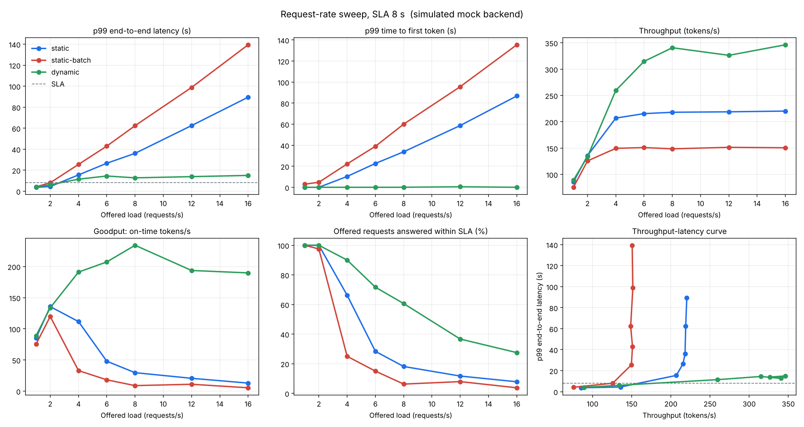

# Technical Report: Dynamic Batching Engine (Project 1)

## 1. Question

How much throughput can a dynamic scheduler gain over static batching at the same p99 latency, and how close does it get to vLLM?

This report covers the part that can be answered without a GPU: scheduler behaviour measured on the simulated backend. The vLLM and Triton comparison on real hardware is prepared (`docs/COMPARISON.md`) but not yet run, so the "how close to vLLM" half of the question is **open**.

## 2. Systems compared

| System | What it does |
|---|---|
| `static` | Fixed concurrency cap of 8 with FIFO waiting, no admission control (the original baseline) |
| `static-batch` | True static batching: wait for 8 requests or 200 ms, run the batch to completion, release every result together |
| `dynamic` | Iteration-level scheduling: SLA-aware admission, AIMD concurrency controller, priority queue with aging, optional token budget |

## 3. Method

- **Simulation, not GPU.** The mock backend decodes at 80 tokens/s per stream and slows each stream by the square root of the concurrency, so aggregate throughput grows with the square root of the batch (`--mock-contention 0.5`). That curve matches the scaling the admission controller already assumes for the reference laptop GPU. It validates scheduling logic; the absolute numbers are not GPU measurements.
- **Workload.** One seeded Poisson arrival stream per offered rate, 20 s of traffic per level, log-normal chat-like lengths (prompt median 40 tokens, output median 80, output capped at 256). Every system sees the identical request sequence.
- **SLA.** 8 s end-to-end for every system. A request is on time when it completes within the SLA; goodput counts only on-time tokens. Rejected requests count as misses.
- **Single run per level.** p99 over 20 to 320 requests is close to the maximum sample, so small differences are noise. `--repeats` (median over seeds) exists for the GPU runs.

## 4. Results: static vs static-batch vs dynamic

| target | offered rps | served / offered | rejected | tokens/s | goodput tok/s | p50 s | p99 s | p99 TTFT s | within SLA |
|---|---:|---:|---:|---:|---:|---:|---:|---:|---:|
| static | 1 | 20 / 20 | 0 | 85 | 85 | 1.30 | 3.72 | 0.03 | 100% |
| static | 2 | 40 / 40 | 0 | 136 | 136 | 1.77 | 4.46 | 0.03 | 100% |
| static | 4 | 80 / 80 | 0 | 207 | 112 | 6.46 | 15.51 | 10.36 | 66% |
| static | 6 | 120 / 120 | 0 | 215 | 48 | 14.29 | 26.61 | 22.69 | 28% |
| static | 8 | 160 / 160 | 0 | 218 | 30 | 21.19 | 36.04 | 33.79 | 18% |
| static | 12 | 240 / 240 | 0 | 219 | 21 | 33.26 | 62.48 | 58.73 | 12% |
| static | 16 | 320 / 320 | 0 | 220 | 13 | 47.15 | 89.50 | 86.82 | 8% |
| static-batch | 1 | 20 / 20 | 0 | 75 | 75 | 3.09 | 4.19 | 3.01 | 100% |
| static-batch | 2 | 40 / 40 | 0 | 126 | 120 | 5.52 | 8.05 | 4.81 | 98% |
| static-batch | 4 | 80 / 80 | 0 | 150 | 33 | 13.29 | 25.51 | 22.26 | 25% |
| static-batch | 6 | 120 / 120 | 0 | 151 | 18 | 23.78 | 42.93 | 39.01 | 15% |
| static-batch | 8 | 160 / 160 | 0 | 149 | 9 | 36.41 | 62.37 | 60.06 | 6% |
| static-batch | 12 | 240 / 240 | 0 | 151 | 11 | 53.63 | 98.82 | 95.65 | 8% |
| static-batch | 16 | 320 / 320 | 0 | 151 | 5 | 71.23 | 139.40 | 135.44 | 4% |
| dynamic | 1 | 20 / 20 | 0 | 89 | 89 | 1.14 | 4.07 | 0.03 | 100% |
| dynamic | 2 | 40 / 40 | 0 | 134 | 134 | 1.62 | 6.08 | 0.04 | 100% |
| dynamic | 4 | 80 / 80 | 0 | 260 | 191 | 2.70 | 11.46 | 0.03 | 90% |
| dynamic | 6 | 100 / 120 | 20 | 315 | 207 | 3.14 | 14.47 | 0.03 | 72% |
| dynamic | 8 | 111 / 160 | 49 | 341 | 234 | 3.16 | 12.73 | 0.07 | 61% |
| dynamic | 12 | 106 / 240 | 134 | 326 | 194 | 4.00 | 13.87 | 0.54 | 37% |
| dynamic | 16 | 109 / 320 | 211 | 346 | 190 | 3.60 | 15.03 | 0.04 | 28% |

Capacity at equal p99 (p99 within the SLA with at most 1% rejected):

| target | max rps with p99 within SLA | peak goodput tok/s | at rps | peak tok/s |
|---|---:|---:|---:|---:|
| static | 2 | 136 | 2 | 220 |
| static-batch | 1 | 120 | 2 | 151 |
| dynamic | 2 | 234 | 8 | 346 |



### Reading

- **Throughput.** At saturation (16 requests/s offered) dynamic sustains 346 tokens/s against 220 for the fixed cap (+57%) and 151 for true static batching (+130%). The gain comes from raising concurrency above the static cap when the queue builds.
- **Goodput.** Static policies collapse once load passes capacity because every request waits behind a growing queue and finishes late. Dynamic sheds the requests that cannot meet the SLA and keeps serving others on time, so its on-time token rate stays near its peak (234 tokens/s at 8 requests/s, against 30 for the cap and 9 for static batching).
- **Time to first token.** Dynamic's p99 TTFT stays under 1 s at every rate; the static policies' TTFT grows with the queue, to 87 s and 135 s at 16 requests/s.
- **Where dynamic does not win.** At 1 to 2 requests/s all three are equivalent within run-to-run noise. Capacity at equal p99 is the same for `static` and `dynamic` (2 requests/s): from 4 requests/s the p99 of dynamic's *served* requests exceeds the 8 s SLA (11.5 s at 4 requests/s) because the controller raises concurrency, which slows each stream, and long outputs then run past the deadline. Dynamic trades some tail latency of long requests for much higher aggregate throughput and goodput; it does not hold the p99 of every served request under the SLA in this simulation. The guide asks for gains "at equal or better p99": this result meets that at low load and does not at high load, and tightening it (for example per-request deadline-aware token limits) is the open improvement.
- **True static batching is the worst baseline here**, as expected: short requests wait for the longest request in their batch and the batch leaves the GPU partly idle.

## 5. Results: queue ordering on the dynamic engine

FCFS, shortest-job-first and priority-with-aging, three seeds per level (median), same SLA.

| target | offered rps | served / offered | rejected | tokens/s | goodput tok/s | p50 s | p99 s | p99 TTFT s | within SLA |
|---|---:|---:|---:|---:|---:|---:|---:|---:|---:|
| dynamic:fcfs | 2 | 30 / 30 | 0 | 147 | 147 | 1.80 | 6.21 | 0.03 | 100% |
| dynamic:fcfs | 6 | 78 / 90 | 12 | 306 | 209 | 3.14 | 12.39 | 0.03 | 78% |
| dynamic:fcfs | 10 | 91 / 150 | 59 | 333 | 244 | 3.44 | 12.00 | 0.03 | 54% |
| dynamic:sjf | 2 | 30 / 30 | 0 | 143 | 143 | 1.80 | 6.29 | 0.03 | 100% |
| dynamic:sjf | 6 | 79 / 90 | 11 | 303 | 206 | 3.26 | 12.73 | 0.03 | 76% |
| dynamic:sjf | 10 | 85 / 150 | 65 | 338 | 223 | 3.26 | 13.37 | 0.06 | 49% |
| dynamic:priority | 2 | 30 / 30 | 0 | 151 | 151 | 1.50 | 5.38 | 0.03 | 100% |
| dynamic:priority | 6 | 79 / 90 | 11 | 305 | 212 | 3.21 | 12.49 | 0.03 | 78% |
| dynamic:priority | 10 | 83 / 150 | 67 | 335 | 205 | 3.37 | 14.73 | 0.04 | 46% |

| target | max rps with p99 within SLA | peak goodput tok/s | at rps | peak tok/s |
|---|---:|---:|---:|---:|
| dynamic:fcfs | 2 | 244 | 10 | 333 |
| dynamic:sjf | 2 | 223 | 10 | 338 |
| dynamic:priority | 2 | 212 | 6 | 335 |

Ordering has little effect in this workload: all requests share one priority, and admission control already drops the requests that cannot meet their SLA, so the dynamic engine's behaviour is dominated by admission and concurrency, not by which waiting request is picked next. Differences between the three are inside the run-to-run spread. SJF would be expected to help when long outputs dominate the queue for longer than the SLA allows; that needs the GPU run and a heavier-tailed length distribution to show.

## 6. What is verified, and what is not

| Claim | Evidence |
|---|---|
| Static-batch waits for N or a timeout, runs the batch to completion, releases results together | unit tests in `tests/test_spec_requirements.py` |
| Token budget caps in-flight tokens and never deadlocks on an oversized request | unit tests |
| FCFS, SJF and priority order requests as specified, with aging | unit tests |
| TTFT, per-token latency and goodput are computed from enqueue time and exposed on responses and `/stats` | unit tests |
| Load client reads vLLM, Triton and VelocityLLM stream formats | tests against fake servers |
| Scheduling policies behave as in section 4 and 5 | simulated sweep, saved in `results/` |
| Throughput and latency on a real GPU against vLLM and Triton | **not yet measured** |
| Chunked prefill effect | **not yet measured** (flag is wired to vLLM) |
| Triton model files run | **not yet run** |

## 7. Next measurements on the GPU

1. `tools/rate_sweep.py --policies static,static-batch,dynamic --repeats 3` on the RTX machine with the real model, then the same SLA against `vllm serve` and the two Triton models (`docs/COMPARISON.md`).
2. Chunked prefill on and off with a long-prompt mix.
3. Report where vLLM wins plainly: it already implements continuous batching, so the project's claim is to build, measure and explain.

Reproduce the tables above:

```bash
python3 tools/rate_sweep.py --mock --policies static,static-batch,dynamic --rps 1,2,4,6,8,12,16 --duration 20 --sla-ms 8000 --out-dir results/sweep_mock
python3 tools/rate_sweep.py --mock --policies dynamic:fcfs,dynamic:sjf,dynamic:priority --rps 2,6,10 --duration 15 --repeats 3 --sla-ms 8000 --out-dir results/policy_order_mock
```
